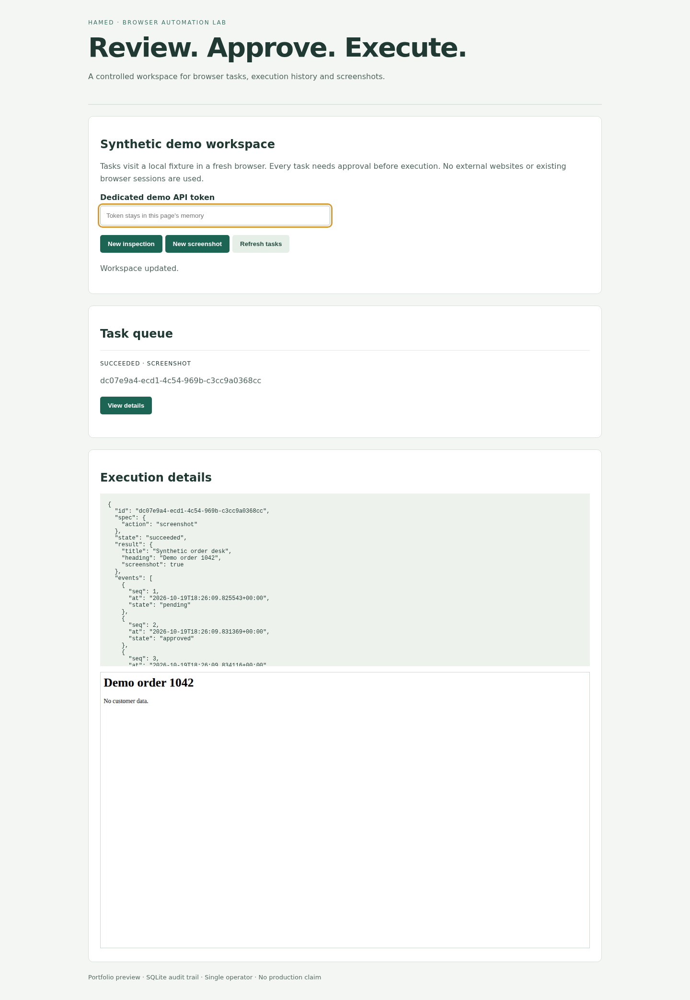

# Browser Automation Workbench

**[Hamed Minaei](https://github.com/hamed665) · Project maintainer & integration engineer**

**My engineering scope:** Single-use approvals, execution logs, protected screenshots, upstream controller confirmation and cancellation/replay handling.

[My contributions & implementation evidence](MY_CONTRIBUTIONS.md) · [Implementation PR](https://github.com/hamed665/ai-browser-automation-agent/pull/1) · [Architecture](#architecture) · [Testing](#testing)

A portfolio engineering project by [Hamed Minaei](https://github.com/hamed665): review browser tasks, approve execution, inspect audit history, and capture screenshots in a controlled demo.

**Status: local portfolio preview.** The new workbench is isolated from the inherited Gradio application's dependencies. The original LLM application remains a security-blocked legacy integration. This repository is not production-ready and has no hosted live demo.

## Features

- Persistent SQLite task queue with pending, approved, rejected, running, succeeded and failed states.
- Atomic, single-use approval: stale decisions and repeat execution return HTTP 409.
- Responsive dashboard, protected screenshots, chronological execution events and sanitized failure records.
- Real Playwright Chromium execution in a fresh context against a bundled synthetic fixture.
- Default-deny action confirmation inserted into the upstream `CustomController.act` before both ordinary and MCP dispatch. Each callback challenge binds a fresh nonce to the exact action and parameters; unavailable, incorrect or expired confirmation denies execution.
- No production accounts, API keys, model calls, customer data or existing browser profiles are needed.

## Architecture

The dashboard calls a bearer-protected FastAPI service. Task specifications are immutable after creation. SQLite records state changes in transactions. Approval allows one attempt; a bounded runner creates a fresh browser, reads the local fixture, optionally captures a screenshot, and closes the context. The runner permits only the exact local fixture URL and disables page JavaScript and downloads.

`workbench/` is the new implementation. `src/` contains the inherited browser-use/Gradio agent. Its controller now calls the approval module, using the existing human-response callback. **The new task dashboard does not orchestrate the legacy LLM agent.** Full SDK/model integration is not verified; controller dispatch is exercised using SDK boundary doubles over its actual method body.

## Installation

Use Python 3.12+ and [uv](https://docs.astral.sh/uv/).

```bash
git clone https://github.com/hamed665/ai-browser-automation-agent.git
cd ai-browser-automation-agent
git switch feat/approval-task-workbench
uv sync --locked
uv run playwright install --with-deps chromium
```

Run only the isolated workbench for this demo. Do not install the legacy `requirements.txt` into this environment.

## Configuration

Copy `.env.example` to a local environment file or export the variables explicitly. The application reads process environment; it does not automatically load `.env`.

```bash
export WORKBENCH_API_TOKEN="$(uv run python -c 'import secrets; print(secrets.token_urlsafe(32))')"
export WORKBENCH_BASE_URL=http://127.0.0.1:3188
export WORKBENCH_DATA=.data
uv run uvicorn workbench.app:create_app --factory --host 127.0.0.1 --port 3188
```

Open `http://127.0.0.1:3188`, enter the dedicated local token, create a screenshot task, approve it, run it, and inspect its details. The target is fixed to the included fictional order desk. Task creation accepts only `inspect` and `screenshot`; arbitrary URLs or extra fields are rejected.

## Security

Keep this service on loopback. The bearer token fails closed when missing or shorter than 16 characters, is not saved by the dashboard, and is required for task data and screenshots. The fixture and empty dashboard shell are public locally. SQLite uses restricted file permissions. This is a single-operator tool without tenant isolation, user accounts, durable worker recovery, storage quotas or a hardened public deployment boundary. Cancelled requests record a terminal failure and consume their approval; a process crash can still leave a task marked running; do not reuse its old approval.

The controller confirmation is a guardrail, not a browser sandbox. Its challenge hides common secret fields and URL credentials/query strings; this heuristic is not a general personal-data detector. Do not provide sensitive inputs. Every browser/MCP action except `done` and `ask_for_assistant` requires confirmation, including reading/navigation actions. That conservative policy trades convenience for explicit control.

An earlier resolved legacy dependency audit found **119 advisory entries in 15 packages**, including Gradio, LangChain, MCP and Pillow. Resolution/advisory counts can change. The independent `legacy-security` CI job intentionally remains blocking until remediation. Do not expose the old Gradio/Docker deployment or use its documented default VNC password. The new environment's audit does not certify the old application.

## Testing

```bash
uv run pytest tests-workbench -q
uv run ruff check workbench tests-workbench examples
uv run ruff format --check workbench tests-workbench examples
uv run python -m py_compile src/controller/custom_controller.py
uv run python examples/browser_smoke.py
uv run pip-audit
```

Ten focused tests cover callback confirmation/replay/redaction, the actual controller dispatch gate, atomic transitions, API authentication/validation, rejection, single-use execution, sanitized failures, cancellation/replay rejection and loopback restrictions. The smoke scenario starts a disposable local server, executes real Chromium, checks the screenshot PNG and records dashboard screenshots at 320/1440 pixels. GitHub Actions uploads that evidence. See [verification](docs/VERIFICATION.md) for the measured baseline and limits.

## Attribution

Derived from [browser-use/web-ui](https://github.com/browser-use/web-ui), commit `61962296c38a0d064e0ba02c827192b7a81d1819` (2026-05-15). The original source, MIT license, copyright notices and Git history remain intact. The original README and environment example are retained in `docs/`.

My additions are `workbench/`, `tests-workbench/`, `examples/browser_smoke.py`, the new environment/lock/configuration, verification documentation and CI workflow. The original controller has an explicit pre-dispatch approval hook. Original browser-use/Gradio/model integrations are upstream work. No claim is made to original authorship of that foundation.



The upstream MIT license permits derivatives subject to retention of its notice. Dependencies have separate licenses; the legacy dependency inventory and commercial provider/model terms require separate review before distribution or hosted use. This demo makes no provider calls.
